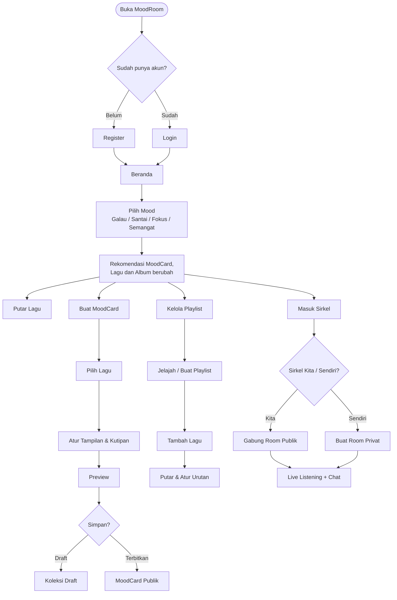
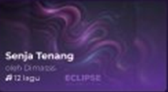
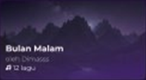

<div align="center">

# 🎧 MoodRoom

### Musik untuk setiap suasana hati.

Platform streaming musik berbasis *mood* yang menggabungkan lagu, kurasi **MoodCard**, playlist pribadi, dan **Sirkel** — ruang mendengarkan musik bersama teman.

<br>


**Tugas Akhir Mata Kuliah Desain Web — Kelompok 5**

</div>

---

## 📖 Daftar Isi

- [Tentang Proyek](#-tentang-proyek)
- [Fitur Utama](#-fitur-utama)
- [Halaman & Navigasi](#-halaman--navigasi)
- [Alur Pengguna](#-alur-pengguna)
- [Teknologi yang Digunakan](#-teknologi-yang-digunakan)
- [Struktur Proyek](#-struktur-proyek)
- [Cara Menjalankan](#-cara-menjalankan)
- [Akun Demo](#-akun-demo)
- [Panduan Penggunaan](#-panduan-penggunaan)
- [Detail Teknis](#-detail-teknis)
- [Desain & Design System](#-desain--design-system)
- [Batasan & Catatan](#-batasan--catatan)
- [Tim & Dosen Pengampu](#-tim--dosen-pengampu)
- [Kredit & Lisensi](#-kredit--lisensi)

---

## 🌙 Tentang Proyek

**MoodRoom** adalah sebuah *prototype* aplikasi web musik yang dirancang untuk menjawab satu pertanyaan sederhana:

> *"Lagu apa yang cocok untuk suasana hatiku sekarang?"*

Alih-alih hanya menampilkan daftar lagu, MoodRoom menghadirkan pengalaman mendengarkan yang **personal, emosional, dan sosial**. Pengguna dapat memilih suasana hati, mendapatkan rekomendasi lagu yang menyesuaikan, membuat **MoodCard** berisi kutipan lirik dan catatan pribadi, menyusun playlist, hingga mendengarkan musik bersama teman melalui fitur **Sirkel**.

Seluruh antarmuka dibangun dari nol menggunakan **HTML, CSS, dan JavaScript murni** (vanilla), dengan Bootstrap 5 sebagai fondasi komponen dan sentuhan desain kustom bernuansa *dark purple* yang hangat.

### ✨ Konsep Utama

| Konsep | Penjelasan |
|---|---|
| 🎨 **Mood-driven UI** | Warna, konten, lagu, dan album berubah mengikuti mood yang dipilih. |
| 💌 **MoodCard** | Kartu kurasi berisi lagu, kutipan lirik, catatan, sampul, dan identitas pembuat. |
| 👥 **Sirkel** | Ruang mendengarkan musik bersama — publik maupun privat. |
| 🔐 **Akun lokal** | Registrasi & login tersimpan di `localStorage` tanpa backend. |
| 📱 **Fully responsive** | Tampilan desktop 3 kolom, tablet, dan mobile dengan bottom sheet player. |

---

## 🚀 Fitur Utama

### 1. 🏠 Beranda yang Hidup

- **Sapaan dinamis** — “Selamat Pagi / Siang / Sore / Malam” menyesuaikan jam perangkat.
- **Mood Slider 4 mode** — Galau 🥺, Santai ☕, Fokus 🎧, Semangat 🔥.
- Saat mood diganti, seluruh konten berubah secara langsung:
  - Gradasi dan ornamen *hero*,
  - Rekomendasi **MoodCard**,
  - Daftar **lagu trending**,
  - Daftar **album populer**.
- **Pencarian global** dengan filter kategori: Semua, MoodCard, Lagu, Album.
- **Empty state** ketika hasil pencarian tidak ditemukan.
- **Animasi halus** berupa *fade-scale-in*, equalizer, orb dekoratif, dan partikel reaksi.

### 2. 💌 MoodCard Studio

Pembuat MoodCard berbentuk *wizard* multi-langkah:

| Langkah | Yang Dilakukan |
|---|---|
| **1. Pilih Lagu** | Cari lagu, filter genre (Pop, Indie, Rock, R&B), pilih beberapa lagu sekaligus. |
| **2. Atur MoodCard** | Isi judul, kutipan lirik (maks. 100 karakter), catatan kurator, unggah sampul, pilih font, perataan teks, warna teks, ukuran font, dan mood. |
| **3. Preview** | Melihat hasil akhir secara *real-time* sebelum diterbitkan. |
| **4. Koleksi** | Simpan sebagai **Draft** atau **Terbitkan**, lalu kelola di tab *Dipublikasikan* / *Draft*. |

Fitur pendukung:

- 📤 **Unggah sampul** dari perangkat (dibaca via `FileReader`, tanpa upload server).
- 🎨 **5 pilihan warna teks** dan **3 pilihan font** (Montserrat, Serif, Monospace).
- ↔️ **Perataan teks** kiri, tengah, kanan.
- 📝 **Penghitung karakter** otomatis.
- ✏️ **Edit draft**, 👁️ **lihat kartu**, 🗑️ **hapus**, dan 🔗 **bagikan**.
- 💾 Semua MoodCard tersimpan otomatis di `localStorage`.

### 3. 🎵 Music Player Interaktif

- Bottom player yang tersedia di seluruh halaman utama aplikasi.
- Kontrol lengkap: **play/pause, previous, next, shuffle, repeat**.
- **Progress bar** yang bisa diklik dan di-*drag* (scrubber) dengan *tooltip* waktu.
- **Volume 10 tingkat** + tombol *mute* dengan ikon adaptif.
- **Visualizer** equalizer animasi.
- **Reaksi emoji** melayang (❤️, 🔥, ✨, dll.).
- **Detail lagu** dalam modal: sampul, artis, durasi, progress, tombol putar, suka, dan tambah ke playlist.
- **Mobile player sheet** — panel pemutar *offcanvas* dari bawah pada layar kecil.
- **Guest limit** — tamu dapat memutar musik maksimal 1 menit, lalu diarahkan untuk masuk.
- Status pemutar (lagu, posisi, volume, sidebar) **tersimpan** dan dipulihkan saat berpindah halaman.

### 4. 🔐 Autentikasi & Profil

- **Registrasi** dengan validasi nama, username (`3–20` karakter), email, dan password (min. 6 karakter).
- **Login** menggunakan username **atau** email.
- **Show/hide password**, opsi “Ingat saya”, dan pesan error yang jelas.
- **Proteksi UI berbasis sesi** — menu Sirkel, koleksi pribadi, dan panel kanan disembunyikan untuk tamu; halaman login/register otomatis dialihkan bila sudah masuk.
- **UI adaptif** — tamu melihat tombol Masuk/Daftar; pengguna login melihat avatar, notifikasi, dan menu profil.
- **Halaman profil** berisi MoodCard kurator, galeri karya, statistik, dan informasi akun.
- **Edit profil** — nama, username, bio, lokasi, mood, dan foto profil (JPG/PNG maks. 2 MB).
- **Kelola akun** dengan tab Informasi, Keamanan, Privasi, Notifikasi, dan Keluar.
- **Bagikan profil** melalui salin tautan, WhatsApp, Web Share API, dan **QR Code**.

### 5. 📚 Playlist & Koleksi Lagu

- **Jelajah Playlist** — 8 playlist kurasi dengan pencarian serta filter genre (Pop, Rock, Indie, Dangdut, Jazz, Lo-fi).
- **Detail playlist** — pencarian, pengurutan (terbaru, A–Z, artis, durasi), total lagu & menit.
- **Putar semua** dan **acak lagu**.
- **Tambah lagu ke playlist** melalui modal pemilih playlist.
- **Buat playlist baru** langsung dari sidebar.
- **Hapus lagu** dari playlist dan **hapus playlist**.
- **Lagu Disukai** — daftar lagu favorit dengan hapus, cari, urutkan, putar semua, dan acak.
- **Lagu Populer** — filter region (Indonesia/Global), mood, dan periode, lengkap dengan pencarian.

### 6. 👥 Sirkel — Dengar Bareng

- **Sirkel Kita** — jelajahi 8 ruang publik yang sedang “mengudara”, lengkap dengan pencarian dan filter genre (Indie, Pop, Rock).
- **Sirkel Sendiri** — buat ruang privat dengan kode room, kelola daftar room pribadi.
- **Room** — sekarang diputar, jumlah pendengar *live*, antrean **Pass the AUX**, dan **obrolan room**.
- **Widget beranda** — Status Vibe Teman yang berubah otomatis, jumlah pendengar yang berfluktuasi, tombol gabung/keluar, dan salin kode room.
- **Efek sosial** — partikel reaksi melayang dari panel Sirkel secara berkala.

### 7. ⭐ Premium & Free

- Halaman paket **MoodRoom Free** dan **MoodRoom Premium**.
- Pilihan paket premium: **1 Bulan (Rp 29.000)**, **3 Bulan (Rp 79.000)**, dan **12 Bulan (Rp 249.000)**.
- Perbandingan fitur Free vs Premium dalam tabel.
- Alur pemilihan paket yang interaktif dengan notifikasi.

### 8. 🎨 UI/UX & Aksesibilitas

- Desain **dark mode** konsisten: ungu tua, ungu panel, dan aksen pink.
- **Sidebar dapat diciutkan** di desktop dan menjadi *offcanvas* di mobile.
- **Toast notification** untuk setiap aksi penting.
- **Modal, dropdown, offcanvas** dari Bootstrap dengan kustomisasi penuh.
- **Keyboard support** — lagu dapat diputar dengan `Enter` / `Space`.
- **ARIA labels** pada tombol ikon dan elemen interaktif.
- Menghormati **`prefers-reduced-motion`** untuk pengguna yang sensitif terhadap animasi.
- **Responsif** di berbagai ukuran layar (mobile, tablet, desktop, layar lebar).

---

## 🗺️ Halaman & Navigasi

| # | File | Halaman | Fungsi Utama |
|---|---|---|---|
| 1 | `index.html` | 🏠 Beranda | Mood slider, MoodCard, lagu trending, album, pencarian, player |
| 2 | `login.html` | 🔑 Masuk | Autentikasi pengguna |
| 3 | `register.html` | 📝 Daftar | Registrasi akun baru |
| 4 | `playlist.html` | 🧭 Jelajah Playlist | Eksplorasi playlist & detail playlist |
| 5 | `lagu_populer.html` | 🔥 Lagu Populer | Daftar lagu populer dengan filter |
| 6 | `lagu_disukai.html` | 💖 Lagu Disukai | Koleksi lagu yang disukai |
| 7 | `profile-new.html` | 👤 Profil User | Profil, MoodCard, galeri, info akun |
| 8 | `edit-profile-new.html` | ✏️ Edit Profil | Ubah data profil & avatar |
| 9 | `account-settings-new.html` | ⚙️ Kelola Akun | Informasi, keamanan, privasi, notifikasi |
| 10 | `share-profile-new.html` | 🔗 Bagikan Profil | Salin link, WhatsApp, QR Code |
| 11 | `premium-new.html` | ⭐ Premium | Paket & benefit premium |
| 12 | `free-new.html` | 🆓 Free | Detail paket gratis |
| 13 | `sirkel.html` | 👥 Pilih Sirkel | Memilih Sirkel Kita atau Sirkel Sendiri |
| 14 | `sirkel-kita.html` | 📻 Sirkel Kita | Jelajah room publik |
| 15 | `sirkel-sendiri.html` | 🔒 Sirkel Sendiri | Room privat & kode undangan |
| 16 | `sirkel-room.html` | 🎙️ Sirkel Room | Detail room: live, antrean, chat |

> 💡 Halaman `sirkel*.html` berbagi satu modul (`js/sirkel.js`) yang menampilkan *view* berbeda berdasarkan nama file, sehingga navigasi terasa seperti aplikasi *single-page*.

---

## 🔄 Alur Pengguna



---

## 🛠️ Teknologi yang Digunakan

| Kategori | Teknologi | Keterangan |
|---|---|---|
| **Markup** | HTML5 | Struktur semantik, 16 halaman |
| **Styling** | CSS3 | Custom properties, Flexbox, Grid, animasi, media queries |
| **Framework CSS** | Bootstrap 5.3.3 | Modal, offcanvas, dropdown, toast, grid |
| **Ikon** | Bootstrap Icons 1.11.3 | Ikon antarmuka |
| **Font** | Google Fonts — Montserrat | Tipografi utama (400–800) |
| **Logika** | JavaScript (ES6+) | Vanilla JS, IIFE module pattern, event delegation |
| **Penyimpanan** | Web Storage API | `localStorage` untuk akun, sesi, playlist, MoodCard, dll. |
| **API Browser** | FileReader, Clipboard, Web Share | Upload avatar, salin link, bagikan profil |
| **Library tambahan** | qrcodejs | Pembuatan QR Code di halaman bagikan profil |

### 📊 Skala Proyek

| Komponen | Jumlah |
|---|---|
| Halaman HTML | **16 file** |
| Modul JavaScript | **15 file** (±2.970 baris) |
| File CSS | **2 file** (±14.300 baris) |
| Aset gambar | **8 file** |
| Build tools | **Tidak ada** — langsung jalan di browser |

---

## 📂 Struktur Proyek

```text
DesainWeb_MoodRoom_Kelompok5/
│
├── index.html                  # 🏠 Beranda utama
├── login.html                  # 🔑 Halaman masuk
├── register.html               # 📝 Halaman daftar
├── playlist.html               # 🧭 Jelajah & detail playlist
├── lagu_populer.html           # 🔥 Lagu populer
├── lagu_disukai.html           # 💖 Lagu disukai
├── profile-new.html            # 👤 Profil pengguna
├── edit-profile-new.html       # ✏️ Edit profil
├── account-settings-new.html   # ⚙️ Pengaturan akun
├── share-profile-new.html      # 🔗 Bagikan profil
├── premium-new.html            # ⭐ Paket premium
├── free-new.html               # 🆓 Paket gratis
├── sirkel.html                 # 👥 Pilih sirkel
├── sirkel-kita.html            # 📻 Sirkel publik
├── sirkel-sendiri.html         # 🔒 Sirkel privat
├── sirkel-room.html            # 🎙️ Ruang sirkel
│
├── css/
│   ├── style.css               # 🎨 Stylesheet utama (design system & komponen)
│   └── auth.css                # 🔐 Stylesheet halaman login/register
│
├── js/
│   ├── auth.js                 # Sesi, UI tamu/login, proteksi antarmuka
│   ├── script.js               # ⚙️ Engine bersama: player, toast, playlist, sidebar
│   ├── data.js                 # State & katalog MoodCard
│   ├── home.js                 # Logika beranda & mood
│   ├── song.js                 # Langkah 1 MoodCard: pilih lagu
│   ├── form.js                 # Langkah 2 MoodCard: form & live preview
│   ├── preview.js              # Langkah 3 MoodCard: preview & simpan
│   ├── collection.js           # Koleksi MoodCard (draft/published)
│   ├── controller.js           # Navigasi wizard MoodCard
│   ├── moodcard-modal.js       # Implementasi modal MoodCard mandiri
│   ├── playlist.js             # Logika playlist
│   ├── liked.js                # Logika lagu disukai
│   ├── popular.js              # Logika lagu populer
│   ├── profile.js              # Profil, form, share, premium, akun
│   └── sirkel.js               # Logika sirkel & room
│
├── img/
│   ├── dimas_avatar.png        # Avatar default
│   ├── mood_senja.png          # Sampul MoodCard "Senja Tenang"
│   ├── mood_bulan.png          # Sampul MoodCard "Bulan Malam"
│   ├── mood_ruang.png          # Sampul MoodCard "Ruang Sendiri"
│   └── galeri_1.png … galeri_4.png
│
├── .gitignore
└── README.md
```

---

## ▶️ Cara Menjalankan

Proyek ini **tidak memerlukan instalasi, Node.js, atau build process**. Cukup jalankan di browser.

### Opsi 1 — Buka langsung

```bash
# Clone repository
git clone <URL-REPOSITORY>
cd DesainWeb_MoodRoom_Kelompok5

# Buka index.html di browser
```

> ⚠️ Beberapa browser membatasi `localStorage` dan `Clipboard API` pada protokol `file://`. Untuk pengalaman terbaik, gunakan opsi 2.

### Opsi 2 — Live Server (disarankan)

**Menggunakan VS Code:**

1. Install ekstensi **Live Server**.
2. Klik kanan `index.html` → **Open with Live Server**.
3. Browser akan terbuka di `http://127.0.0.1:5500`.

**Menggunakan Python:**

```bash
# Python 3
python -m http.server 8000

# Buka http://localhost:8000
```

**Menggunakan PHP:**

```bash
php -S localhost:8000
```

### Opsi 3 — Deploy statis

Karena seluruh proyek berupa file statis, proyek dapat langsung diunggah ke:

- GitHub Pages
- Netlify
- Vercel
- Firebase Hosting

---

## 🔑 Akun Demo

Gunakan akun berikut untuk mencoba seluruh fitur tanpa registrasi:

| Field | Nilai |
|---|---|
| **Username** | `dimas` |
| **Email** | `dimas@gmail.com` |
| **Password** | `123456` |

> Akun demo otomatis dibuat saat pertama kali aplikasi dijalankan. Kamu juga dapat membuat akun baru melalui halaman **Daftar**.

---

## 📘 Panduan Penggunaan

### 🎧 Mengubah Mood

1. Buka **Beranda**.
2. Geser slider atau klik salah satu label mood: **Galau, Santai, Fokus, Semangat**.
3. Perhatikan perubahan *hero*, MoodCard, lagu, dan album yang muncul.

### 💌 Membuat MoodCard

1. Dari sidebar, klik **MoodCard Saya** → **Buat MoodCard Baru**.
2. Pilih minimal satu lagu, lalu klik **Selanjutnya**.
3. Atur judul, kutipan lirik, catatan, sampul, font, warna, perataan, dan mood.
4. Klik **Selanjutnya** untuk melihat preview.
5. Pilih **Simpan Draft** atau **Terbitkan**.
6. Kartu akan muncul di koleksi **Dipublikasikan** atau **Draft**.

### 🎵 Memutar Musik

- Klik kartu lagu, baris lagu, atau tombol **Play** pada MoodCard.
- Gunakan tombol **Play/Pause**, **Next**, **Previous** di player bawah.
- Klik atau *drag* progress bar untuk melompat ke durasi tertentu.
- Klik ikon volume untuk mengatur level suara.
- Di mobile, ketuk area lagu pada player untuk membuka **bottom sheet**.

### 📚 Mengelola Playlist

1. Buka **Jelajah Playlist** dari sidebar.
2. Pilih playlist atau buat baru melalui ikon **+** di samping “Playlistku”.
3. Gunakan tombol **Putar Semua** atau **Acak**.
4. Dari menu tiga titik pada lagu, pilih **Hapus dari playlist**.
5. Untuk menambah lagu, gunakan menu **Tambah ke playlist** pada halaman lagu.

### 👥 Menggunakan Sirkel

1. Buka menu **Sirkel**.
2. Pilih **Sirkel Kita** untuk room publik atau **Sirkel Sendiri** untuk room privat.
3. Gunakan pencarian dan filter genre untuk menemukan room.
4. Klik **Gabung** untuk masuk ke room.
5. Di dalam room, lihat lagu yang diputar, antrean **Pass the AUX**, dan kirim pesan di obrolan.

### 👤 Mengatur Profil

1. Klik avatar di kanan atas → **Lihat Profil**.
2. Klik **Edit Profil** untuk mengubah data dan foto.
3. Buka **Kelola Akun** untuk mengatur keamanan, privasi, dan notifikasi.
4. Gunakan **Bagikan Profil** untuk menyalin tautan atau menampilkan QR Code.

---

## ⚙️ Detail Teknis

### 🧩 Arsitektur JavaScript

Proyek menggunakan pola **modular IIFE** tanpa framework:

```js
(() => {
  'use strict';
  // modul mandiri
})();
```

Setiap modul berkomunikasi melalui:

- **Global namespace** — `window.MR`, `window.MCState`, `window.MCStore`, `window.MCStep1-3`, `window.MCController`, `window.MCCollection`, `window.MoodAuth`.
- **Event delegation** — satu listener menangani banyak elemen dinamis.
- **Custom Event** — `mr:filter`, `mr:chat-toggle`, `mrauth:ready`.

#### `js/script.js` — Engine Bersama

Modul terbesar yang dimuat di hampir semua halaman. Tanggung jawabnya:

- Menyimpan & memulihkan state pemutar (`mr-player`, `mr-vol`).
- Mengatur play/pause, next/prev, shuffle, repeat.
- Scrubber dengan `Pointer Events` dan tooltip waktu.
- Volume, mute, reaksi emoji, dan partikel melayang.
- Toast, modal aksi, menu notifikasi, dan menu profil.
- CRUD playlist (`mr-playlists`, `mr-pl-songs`).
- Collapse sidebar dan sinkronisasi player mobile.
- Batas pemutaran tamu (60 detik).

#### `js/auth.js` — Autentikasi & Sesi

- `moodroom_users` — daftar akun.
- `moodroom_session` — sesi aktif.
- `moodroom_profile` — data profil.
- `MoodAuth.login()` / `MoodAuth.logout()` — mengelola sesi aktif.
- `updateGuestInterface()` — menyesuaikan sidebar/panel kanan berdasarkan status login.

#### Wizard MoodCard

| File | Peran |
|---|---|
| `song.js` | Langkah 1 — pencarian, filter genre, multi-select |
| `form.js` | Langkah 2 — binding form, live preview, upload sampul |
| `preview.js` | Langkah 3 — render preview & simpan draft/publish |
| `collection.js` | Menampilkan koleksi MoodCard |
| `controller.js` | Mengatur perpindahan langkah & aksi tombol |
| `data.js` | State global & katalog lagu/mood |
| `moodcard-modal.js` | Versi modal mandiri untuk halaman profil |

### 💾 Kunci `localStorage`

| Kunci | Isi |
|---|---|
| `moodroom_users` | Daftar akun terdaftar |
| `moodroom_session` | Sesi pengguna aktif |
| `moodroom_profile` | Data profil pengguna |
| `moodroom_settings` | Preferensi profil & notifikasi (modul profil) |
| `moodroom_moodcards` | MoodCard dari modal mandiri |
| `mr-moodcards` | MoodCard dari wizard beranda |
| `mr-playlists` | Daftar nama playlist |
| `mr-pl-songs` | Lagu di setiap playlist |
| `mr-liked` | Lagu yang disukai |
| `mr-player` | Lagu, status putar, dan posisi terakhir |
| `mr-vol` | Level volume |
| `mr-side` | Status collapse sidebar |
| `moodroom_editing_moodcard` | ID MoodCard yang sedang diedit |

### 🎨 Strategi CSS

- **Design token** melalui CSS custom properties di `:root`:
  ```css
  :root {
    --bg: #1c0b30;
    --panel: #3b1a62;
    --card: #4f2a84;
    --card2: #5a35a0;
    --pink: #d96fb0;
    --line: rgba(255, 255, 255, 0.12);
    --player-h: 76px;
  }
  ```
- **Layout desktop 3 kolom** dengan *internal scroll*:
  - Sidebar kiri — navigasi & playlist.
  - Main — konten utama.
  - Panel kanan — status teman & sirkel.
- **Breakpoint responsif** pada `576px`, `768px`, `992px`, `1200px`, `1400px`, dan `1450px`.
- **Animasi** — `fade-scale-in`, equalizer, floating particles, pulse, orb, dan transisi hover.
- **Reduced motion** — animasi dikurangi otomatis bila pengguna mengaktifkannya.

### ♿ Aksesibilitas

- `aria-label`, `aria-expanded`, `aria-checked`, `aria-live`, dan `role` pada elemen interaktif.
- Navigasi keyboard pada kartu lagu dan album.
- Kontras teks yang memadai pada tema gelap.
- Fokus visual pada tombol dan input.

---

## 🎨 Desain & Design System

### 🌈 Palet Warna

| Token | Warna | Penggunaan |
|---|---|---|
| `--bg` |  `#1c0b30` | Latar utama |
| `--panel` |  `#3b1a62` | Panel samping |
| `--card` |  `#4f2a84` | Kartu & komponen |
| `--card2` |  `#5a35a0` | Kartu hover/aktif |
| `--pink` |  `#d96fb0` | Aksen utama |
| `--line` | `rgba(255,255,255,.12)` | Garis & border |

### 🔤 Tipografi

- **Font utama:** Montserrat (400, 500, 600, 700, 800).
- **Hierarki:** judul tebal dan besar, label kecil dengan *letter-spacing*, teks sekunder berwarna putih transparan.
- **Alternatif di MoodCard:** Georgia (serif) dan Courier New (monospace).

### 🖼️ Aset MoodCard

<div align="center">
  
  
  
  <br>
  <sub>Senja Tenang · Bulan Malam · Ruang Sendiri</sub>
</div>

---

## ⚠️ Batasan & Catatan

Proyek ini merupakan **prototype front-end** untuk keperluan pembelajaran, sehingga beberapa hal perlu dipahami:

| Aspek | Kondisi |
|---|---|
| **Backend** | Tidak ada. Semua data disimpan di browser melalui `localStorage`. |
| **Autentikasi** | Simulasi lokal; password tidak di-hash dan tidak aman untuk produksi. |
| **Audio** | Pemutaran **disimulasikan** dengan timer progres — tidak memuat file audio asli. |
| **Sirkel real-time** | Jumlah pendengar, status teman, dan reaksi disimulasikan dengan `setInterval`, bukan WebSocket. |
| **Sinkronisasi** | Data tidak tersinkron antar perangkat atau antar pengguna. |
| **Placeholder** | Beberapa aksi menampilkan pesan “segera hadir” (mis. unduhan, chat tertentu). |
| **CDN** | Bootstrap, ikon, font, dan sebagian gambar memerlukan koneksi internet. |
| **Data pengguna** | Menghapus data browser akan menghapus akun, playlist, dan MoodCard. |
| **Duplikasi halaman Sirkel** | Disengaja agar setiap mode memiliki URL langsung. |

### 🔮 Pengembangan Selanjutnya

- Backend & database untuk akun dan konten yang persisten.
- Streaming audio nyata dengan HTML5 Audio / Web Audio API.
- Sinkronisasi Sirkel menggunakan WebSocket.
- Notifikasi push dan fitur sosial yang lebih dalam.
- PWA agar dapat diinstal di perangkat.

---

## 🎓 Tim & Dosen Pengampu

### 👨‍🏫 Dosen Pengampu

**Vearen Dika Sofirudin, S.Pd., M.Ed.**

Mata Kuliah **Desain Web**

### 👥 Tim Pengembang — Kelompok 5

| No | Jobdesk | Nama | NIM |
|:--:|---|---|---|
| 1 | Ketua Kelompok · Music Player & Engine Bersama | **Dimas Alif Ardiansyah** | K3525004 |
| 2 | UI/UX Designer · MoodCard Studio | **Febriana Putri Qurrota’ayun** | K3525007 |
| 3 | Autentikasi & Halaman Profil | **Zahra Faizza Kuncoroningrum** | K3525017 |
| 4 | Playlist, Lagu & Sirkel | **Muzni Mubarok Salim** | K3525036 |
| 5 | Dokumentasi, Pengujian & Aset Visual | **Aksya Nayla Fitriana** | K3525047 |

---

## 📜 Kredit & Lisensi

- **Desain & pengembangan:** Kelompok 5.
- **Framework:** [Bootstrap 5.3.3](https://getbootstrap.com/) — MIT License.
- **Ikon:** [Bootstrap Icons](https://icons.getbootstrap.com/) — MIT License.
- **Font:** [Montserrat](https://fonts.google.com/specimen/Montserrat) — SIL Open Font License.
- **QR Code:** [qrcodejs](https://github.com/davidshimjs/qrcodejs) — MIT License.
- **Gambar sampul:** Unsplash dan aset internal kelompok.
- **Data lagu & artis:** digunakan hanya untuk keperluan demonstrasi akademik. Seluruh hak cipta tetap milik artis, pencipta, dan label masing-masing.

> Proyek ini dibuat untuk memenuhi tugas akhir mata kuliah **Desain Web** dan tidak untuk tujuan komersial.

---

<div align="center">

### 🎶 “Setiap lagu punya cerita. Setiap mood punya ruang.”

**MoodRoom** — *Musik untuk setiap suasana hati.*

Dibuat dengan 💜 oleh **Kelompok 5**


</div>
